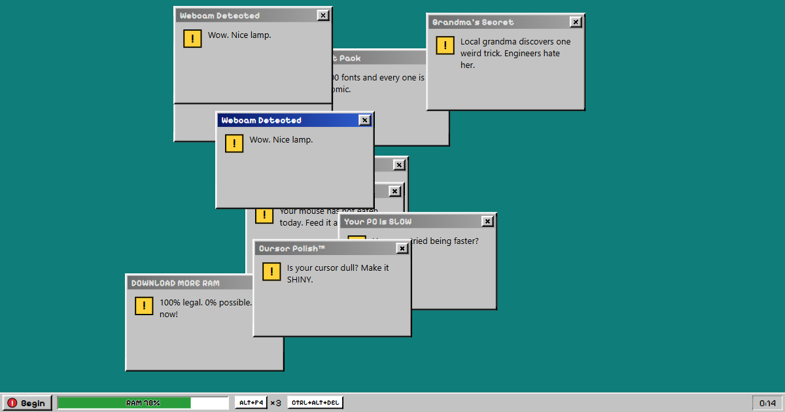

<div align="center">

# 💾 Pop-Up Panic

### Your 90s computer is drowning in pop-ups. You have one mouse. Good luck.

**[▶ Play it now: pop-up-panic.pages.dev](https://pop-up-panic.pages.dev)** · free · no install · no sign-up · runs in any browser


<a href="https://pop-up-panic.pages.dev"></a>

</div>

---

**PanicOS 97** boots up clean. Ten seconds later an ad asks if you want beans. Thirty seconds in, a window starts *running away from your cursor*. By the two-minute mark, a fake antivirus is breeding, a toolbar is eating your screen, a "YOU WON!" box is counting down to disaster, and the RAM bar is screaming red.

Hit 100% RAM for two seconds and the whole machine crashes. Then you hit **Retry**, because you *know* you can do better.

> **DOWNLOAD MORE RAM** — 100% legal. 0% possible. Click now!
>
> **Webcam Detected** — Wow. Nice lamp.
>
> **Hamster Upgrade** — Your CPU is powered by 1 hamster. Upgrade to 2.
>
> *(real pop-ups from the game. There are dozens.)*

## 🎮 Why it's fun

- **Every pop-up is a joke, and most are traps.** Eight window types, each with its own dirty trick and its own counter:

  | Pop-up | The trick | How you beat it |
  |---|---|---|
  | 📢 **Ad** | Just rude | Click the X |
  | ❌ **Fake X** | The big X is a lie and spawns *another* ad | Find the tiny "no thanks" link |
  | 🏃 **Runner** | Slides away from your cursor | Chase it until it runs out of breath |
  | 🎁 **YOU WON!** | 3-second countdown, then 4 ads explode out | Close it before zero |
  | ☣️ **Virus Scan** | Closing it spawns two more | Hit "Cancel scan" |
  | ❓ **Are you sure?** | "Really sure?" "Final answer?" | Click through fast |
  | 🔍 **Toolbar** | Installs a strip that shrinks your desktop | Uninstall it from the tray |
  | 🛡️ **Antivirus** | The one *friendly* window: it closes things for you | Leave it alone! |

- **Fair chaos.** Every trick flashes a 300 ms warning before it fires. If you lose, you saw it coming.
- **Panic buttons.** `ALT+F4` force-quits the window under your cursor (3 charges). `CTRL+ALT+DEL` nukes every hostile window, once per run. Timing them is the whole game.
- **Every run is new, every run counts.** You get a fresh random seed every time, and any run can land on the **all-time global top 10**, signed with your 3-letter arcade initials.
- **Brag in emoji.** Share your run as a RAM strip that tells the whole story:
  ```
  Pop-Up Panic — 1:34 💾 87 closes 🔥x6
  🟩🟩🟨🟨🟧🟥🟥💥
  ```
- **It *feels* like 1997.** Bevelled windows, a "Begin" button, CRT scanlines on the crash screen, screen shake as RAM climbs, and a modem-screech crash sound. All of it is synthesized live, with zero audio files.

## 🛠️ Under the hood

A small game with serious engineering behind it.

- **A fully deterministic simulation.** The game rules (`src/sim/`) are pure TypeScript: integers only (pixels, milli-percent RAM, 60 Hz ticks), one seeded RNG, and no DOM, `Date` or `Math.random`. The same seed plus the same inputs gives the exact same run, every time, on every machine. Each submitted score carries its full input log, so any run can be replayed tick by tick.
- **A fixed-timestep engine.** `requestAnimationFrame` feeds an accumulator that steps the sim at exactly 60 Hz. The renderer only *reads* state, so a slow frame never changes the outcome.
- **No framework, tiny bundle.** The desktop is one 1280×720 `div` scaled to any screen, with windows as plain DOM nodes. The whole game ships as **~18 kB of gzipped JavaScript**.
- **Tuned by a robot.** A balance bot (`npm run sim:bot`) plays 200 seeded runs headless. Its median survival is held at 90–140 s, so the game is hard but beatable.
- **A serverless leaderboard.** Cloudflare Pages Functions + D1 (SQLite at the edge). Initials go through a rude-word blocklist on both client and server. Raw IPs are never stored (they're salted and hashed), and submissions are rate-limited.
- **150 tests.** Vitest covers every pop-up type, the spawn director, determinism, the API and storage.
- **It never shows a dead page.** If anything throws, you get a *Blue Screen of Panic* with a Reboot button.
- **Playable on phones.** Landscape scaling, on-screen panic buttons and 44 px touch targets.

## 🚀 Run it locally

```bash
npm install
npm run dev
```

| Command | What it does |
|---|---|
| `npm run dev` | Game on localhost:5173 |
| `npm test` / `npm run test:sim` | All tests / only the simulation |
| `npm run typecheck` · `npm run build` | Type-check, production build |
| `npm run sim:bot` | 200-run balance report |
| `npm run dev:api` | Local leaderboard on :8788 (after a build) |

On Windows, `scripts/setup.ps1` installs everything in one go.

## 📁 What's in here

| Path | What |
|---|---|
| `src/sim/` | The pure, deterministic game simulation and its tests |
| `src/app/` | Renderer, input, effects, sound, share text, leaderboard client |
| `worker/`, `functions/` | Leaderboard API (Pages Functions) and the D1 schema and migrations |
| `docs/SPEC.md` | Game rules and numbers |
| `docs/ARCHITECTURE.md` | Code layout, determinism rules, API |
| `docs/PLAN.md` | The weekend plan, milestone by milestone |
| `docs/COPY.md` | Every in-game joke |
| `CLAUDE.md`, `claude-setup/` | The Claude Code setup: skills, subagents, hooks |

---

<div align="center">

PanicOS 97 is an original fake operating system. No real OS names, logos or UI were harmed.

**[Can you survive two minutes? →](https://pop-up-panic.pages.dev)**

</div>
